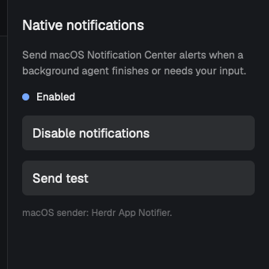

# Herdr App Notifier

A compact Herdr App panel that enables native macOS notifications when a background agent finishes or needs input. 

## What you see

A setup panel with enable/test controls and current local state. After setup, **Hide panel (keep notifications)** hides its UI while the hidden layout block keeps monitoring. Notification Center alerts use the Herdr app icon.

## How it behaves

The mod observes Herdr App's reactive `agents()` data and scans its in-memory snapshot once per second so a hidden copy keeps monitoring. It sends one notification for a transition to `done` or `blocked`, silently seeds agents already present when the mod starts, and defers a focused agent's alert until it leaves focus. If it returns to `idle` first, no alert is sent. The enable setting is stored per mod copy in local storage.

## Built from

- `mod/main.js`: panel, reactive observer, and `exec()` calls to the local helper.
- `mod/transitions.js`: pure transition detection and notification text.
- `mod/mod.json`: docks the panel at the right.
- `native/HerdrNotifier.swift`: macOS Notification Center sender.
- `scripts/build-native.sh`: builds an ad-hoc-signed universal helper and embeds the Herdr app icon supplied by the installer.

The helper is local and makes no network requests. It does not use `terminal-notifier` or AppleScript.

## Watch out

- macOS permission must be enabled for **Herdr App Notifier**.
- The helper uses Apple's deprecated `NSUserNotificationCenter` API. On the tested macOS 27 machine, `UserNotifications` rejected the ad-hoc-signed helper during client validation.
- The mod must remain in the active Herdr App layout to observe agents. Hiding its block keeps it active; removing the block stops notifications.
- Notifications do not currently include a click-to-focus action.
